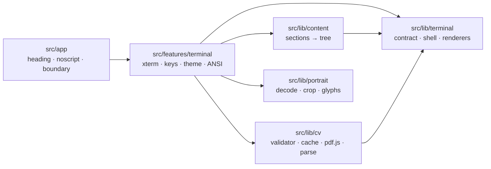

# AGENTS.md

Project instructions for AI coding agents. Shared baseline rules (git flow, testing,
architecture, safety) come from the user-level `AGENTS.md`; this file adds
project-specific detail and wins on conflict.

## Project Overview

Portfolio is Mario Di Modica's personal site: a terminal and nothing else. One
full-viewport xterm session is the whole document — no router, no store, no header, no
footer, no page behind the grid. It is a static build deployed to GitHub Pages.

The CV PDF is the only content input. `public/cv/mario-dimodica-cv.pdf` is fetched and
parsed in the browser on the first visit, so there is no build step, no generated module
and no prose in the repository: updating the site means replacing the PDF.

## Repository Structure

Single Vite app, no workspaces:

- `src/app/` — the document: hidden `<h1>`, `<noscript>` summary, `<TerminalScreen/>`, error boundary
- `src/features/terminal/` — the view: xterm lifecycle, fit, focus, chords, line editor, theme, ANSI, clipboard
- `src/lib/terminal/` — the pure shell domain: contract, dispatch, commands, layout, output and prompt renderers, keymap
- `src/lib/cv/` — the document at runtime: validator, cache, pdf.js extractor, the layout contract
- `src/lib/content/` — the projection of parsed sections into the shell's files and folders
- `src/lib/portrait/` — the JPEG at runtime: decode, crop, resample, glyphs
- `src/styles/` — `fonts.css` and `terminal.css`; the vendored 0xProto faces (OFL) live in `src/assets/fonts/`
- `src/test/` — Vitest setup and the fixtures every suite builds its inputs from
- `public/` — `cv/mario-dimodica-cv.pdf`, `portrait.jpg`, icons, `.nojekyll`
- `.github/workflows/` — `ci.yml`, `gitleaks.yml`, `deploy.yml`
- `.opencode/` — the gitignored agent workspace: briefs, probes, evidence, scratch scripts

There is no `content/` directory: the content is the PDF under `public/cv/`, and
`src/lib/content/` is the code that turns its parsed sections into files.

Scratch files, probes and logs belong in `.opencode/`, never in a tracked path.

## Development Commands

```bash
npm run dev            # Vite on http://localhost:4300/Portfolio/ (strictPort)
npm run typecheck      # tsc --noEmit, both tsconfig projects
npm run lint           # eslint .
npm run build          # typecheck, then vite build into dist/
npm test               # vitest in watch mode
npm run test:run       # vitest once
npm run test:coverage  # vitest once, v8 coverage with 100% thresholds
npm run format         # prettier . --write
```

- **4300 only.** `vite.config.ts` pins `server.strictPort` and `preview.strictPort` to
  4300, and `base` is `/Portfolio/`, so both servers answer on
  `http://localhost:4300/Portfolio/` and the bare root redirects there. Aurum runs on
  4200 and both projects are routinely open at once: if 4300 is held, stop the other
  instance — never let Vite fall back to another port and never start a second server.
- There is no content command. The PDF and the portrait are static assets the browser
  reads at runtime; to check a document, load the site, which prints the reason the
  contract could not place as `content unavailable: <reason>`.
- Node 26 locally; `ci.yml` and `deploy.yml` pin Node 22.

## Architecture

Each arrow points from the thing that depends to the thing it depends on, and everything
under `src/lib` is pure.



### Pure shell domain

`src/lib/terminal` knows no DOM, no React, no clock, no randomness and no ANSI. A command
takes a `ShellSession` and a `ShellContext` and returns the next session plus `Line[]`,
and asks the host for anything it cannot do itself through flags on `ShellResult`
(`clear`, `toggleTheme`, `script`). Time and randomness are parameters, never reads — the
splash takes `now` and a script takes `random()` — so the domain stays deterministic and a
reprint at another hour is the same reprint.

### Thin view

`src/features/terminal/terminal-screen.tsx` owns xterm and the page, and no shell rule. It
writes the lines the domain returned, schedules the script the domain described, and keeps
focus, fit, theme and clipboard. `src/app` composes the document around it. Nothing in the
view decides what a command prints, and nothing in `src/lib` knows a canvas exists.

### Runtime content pipeline

`loadCv` → `parseCv` → `buildContent` → commands. One `HEAD` for the validator, a
`localStorage["portfolio-cv"]` hit that returns before pdf.js is imported at all, a miss
that fetches the PDF and extracts text items and link annotations with pdf.js
(`src/lib/cv/extract.ts`, the only importer, both imports dynamic so the renderer and its
worker land in their own chunks), then `parseCv` over the layout and a cache write capped
at 200 KB. One promise answers every caller for a URL: a StrictMode second mount joins the
load already running, and a failed load is forgotten so a retry can start over.

### Portrait module

`src/lib/portrait` turns `public/portrait.jpg` into glyph rows: decoded once on the first
`whoami`, probed at 192 px, cropped to head and shoulders, kept as a small RGB grid, then
resampled per invocation onto a ten-glyph ramp at the measured `cellWidth / cellHeight`
ratio. Nothing is fetched at boot, and a missing image or a refused canvas costs the art,
never the panel.

### Theme roles

A painted line is `Line`/`Span`/`Tone`, and the tones are `plain`, `heading`, `dim`,
`accent`, `error`, `success`, `info`. `src/features/terminal/ansi.ts` is the only map from
a tone to an escape sequence; `src/features/terminal/theme.ts` is the only place that holds
a colour, and both palettes are designed rather than one inverted. `theme` flips the
palette, sets `color-scheme`, persists the choice in `localStorage["portfolio-theme"]` and
repaints `document.body`, so no seam shows around the grid.

## Content Contract

- **The PDF is the only content input.** No string the terminal prints about the person is
  typed in the repository: every file in the tree is a projection of the sections the parse
  produced, so `cat cv.pdf` and the per-entry files can never disagree.
- **A layout change needs a parser change.** A new section, a different column gutter,
  another bullet glyph or a reordered marker is a change to `src/lib/cv/parse.ts` — and to
  `src/lib/content/tree.ts` when it changes how a section becomes a file. `parseCv` is pure
  and it refuses: a marker that is missing, doubled or out of order, an entry without a role
  line, fewer than three projects or a line outside any entry is a named `CvParseError`
  carrying the line it could not place, never a silently dropped row.
- **The derived-value exception.** The splash derives four facts — current role, company,
  total experience and stack — at request time, from the parsed CV alone
  (`src/lib/terminal/experience.ts`, `src/lib/terminal/content.ts`). Role, company and
  stack are the current career entry's own fields; the total is the calendar months of the
  CV's periods with overlaps counted once and `Present` resolved against the clock the
  caller passes in, printed `3y`, `3y 2m` or `2m`. Nothing is typed by hand, nothing is
  estimated, and a period the shell cannot read is dropped rather than turned into a wrong
  number. No other screen shows a computed number.
- **No normalisation.** Text prints as the document states it, and a link prints the
  document's own label with its address travelling only as the OSC 8 target. The one row
  the projection drops is the CV's own `Website` link, which points at the abandoned
  Firebase host: dropping it is a projection rule, not a rewrite.
- `export_cv.sh` is the one node the document does not describe. It carries its meaning as
  flags on the node — runnable, not readable — so neither the dispatcher nor the reader
  recognises a file name.

## Terminal Rules

- **One key owner.** `terminal.attachCustomKeyEventHandler` is the only handler for the
  contested chords, and it hands the DOM event and the live session to `resolveKey` in
  `src/lib/terminal/keymap.ts`. Nothing else reads a chord; nothing but the view executes
  one. A playing script resolves every key to `null` — inert, not consumed and cancelled.
- **The keymap resolves everything.** Ctrl/Cmd+C is the visitor's copy with a selection and
  the shell's interrupt without one, decided first so no chord can shadow it. Backspace
  under Ctrl/Option deletes a word and under Cmd empties the line. Tab opens the completion
  menu and then advances it, Shift+Tab walks it back, Escape closes it and only it. Anything
  the map answers `none` for belongs to the line editor.
- **Geometry is measured, never assumed.** `CellMetrics` comes from the screen element's
  own rect over the columns and rows xterm reports, and character art samples by
  `cellWidth / cellHeight` instead of stretching cells square. `FitAddon` refits on mount,
  on `window.resize`, on a `ResizeObserver` and after `document.fonts.ready`, because a cold
  visit would otherwise measure the fallback face.
- **`lineHeight` stays at or above 1.** xterm throws below it, so the row is the font's own
  line box: 0xProto at 16 px is a 9.92 × 24.96 px cell. Never shrink the row to make a cell
  square.
- **ANSI only through theme roles.** A `Tone` goes in and an escape sequence comes out, in
  `src/features/terminal/ansi.ts` and nowhere else. No truecolour: every colour is an xterm
  palette slot chosen by contrast in `theme.ts`, so a theme flip recolours every register
  at once and no writer knows a hex value.
- **`➜` comes from the fallback stack.** 0xProto does not carry U+279C, so the browser draws
  the arrow from the family behind it, on purpose. Nothing measures the arrow, so a fallback
  that resolves differently may change the arrow and never the row.

## Inputs

| Input              | Behaviour                                                                                                                                                                                                    |
| ------------------ | ------------------------------------------------------------------------------------------------------------------------------------------------------------------------------------------------------------ |
| Chords             | Resolved once, on the key press, before xterm can turn the chord into a control byte or a `\x7f`                                                                                                             |
| `Tab`              | Prefix-only completion: one candidate is inserted whole, several open a menu under the prompt, and every later Tab rewrites only the token the menu was opened on                                            |
| `Ctrl`/`Cmd`+click | Follows an OSC 8 target or a URL found in prose; `mailto:` goes to the OS handler, http(s) opens without an opener, and a plain click stays inert so a drag across a link copies instead                     |
| Selection          | Copy on select, with a notice in the grid's own typeface — `copied · 3 lines`, `copied · 128 chars` — that fades, or disappears at once under reduced motion. A refused clipboard is silence, never an error |
| `welcome`          | Reprints the block the boot printed: banner, facts, hints                                                                                                                                                    |
| `export_cv.sh`     | The easter egg: seven paced beats, `just kidding 😂`, a hold, the CV download, the debrief. No key interrupts it                                                                                             |

## Testing

Vitest 4 with happy-dom and Testing Library, configured in `vite.config.ts`: suites are
`src/**/*.test.{ts,tsx}`, setup is `src/test/setup.ts` (jest-dom matchers, cleanup, a
deterministic `matchMedia` that only reports reduced motion), and inputs come from the
builders in `src/test/fixtures/`, so a case states only the field it is about.

The baseline rules in the user-level `AGENTS.md` apply unchanged here: the unit under test
is assigned to `testSubject`, every external is mocked (network, `localStorage`,
`navigator.clipboard`, image decode, canvas contexts, `ResizeObserver`, xterm), inputs come
from factories and assertions from named expectations, repeated shapes are table-driven,
and the public surface is what gets tested — never a private helper.

`npm run test:coverage` is the gate: **100% statements, branches, functions and lines**
over `src/**/*.{ts,tsx}`, excluding the test files, `src/test/**`, `src/vite-env.d.ts` and
`src/main.tsx`. A gap gets a named justification; it never lowers the bar and never deletes
code. A bug fix ships with a test that fails before the fix and passes after.

## CI and Deploy

- `.github/workflows/ci.yml` — on every pull request into `main` only: the same commit already
  ran there, so a merge does not re-run it. `npm ci`, `npm run typecheck`, `npm run lint`,
  `npm run test:run`, then `npm run test:coverage`, whose 100% thresholds sit in the script so a
  gap fails the job instead of warning.
- `.github/workflows/gitleaks.yml` — a full-history secret scan (`fetch-depth: 0`) with
  `.gitleaks.toml`, which extends the default rule set and allowlists the lockfile. The job
  asks for `pull-requests: read` as well as `contents: read`, because the action lists a
  PR's commits and a read-only token failed the run with a 403.
- `.github/workflows/deploy.yml` — on every push to `main` and on demand: `npm ci`,
  `npm run build`, then GitHub Pages publishes `dist/` at
  `https://mxo01.github.io/Portfolio/`. Nothing is extracted, generated or validated in the
  run; the pipeline is a build and a copy. `base: "/Portfolio/"` and `public/.nojekyll` are
  what make a project page work, and there is no SPA fallback because there are no client
  routes.

## Never Run Here

- **No Firebase commands.** This repository used to be an Angular site on Firebase
  Hosting; `firebase.json`, `.firebaserc.json` and the Firebase workflows are gone and the
  site deploys to GitHub Pages. `firebase deploy`, `firebase use` and the rest of that CLI
  have nothing to act on.
- **No branch operation on `main`.** An agent never commits to, pushes or merges into
  `main`: work happens on a `feat/`, `fix/` or `chore/` branch, and the merge into `main` is
  not an agent step in this repository.
- **Nothing destructive.** No `git reset --hard`, no force-push, no `rm -rf`, no deleting
  branches or files this session did not create, and no rewriting of the CV PDF or the
  assets under `public/`.
