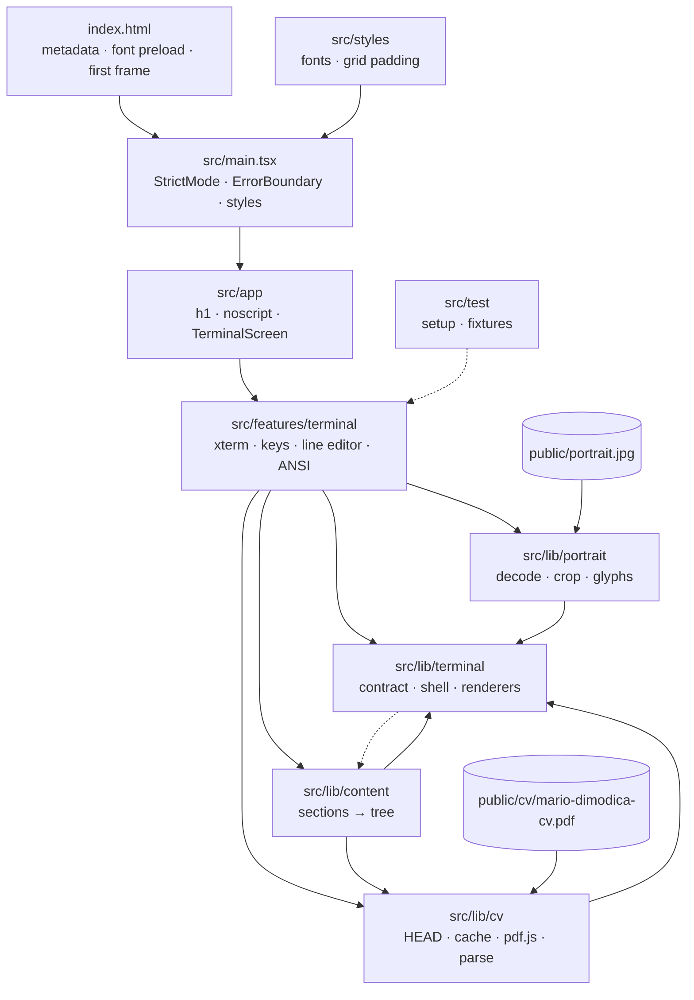

# Portfolio

Mario Di Modica's CV as a terminal: one full-viewport xterm session and nothing else around
it — no navigation, no header, no footer, no page behind the grid.

> Every string the terminal prints comes from the CV PDF
> (`public/cv/mario-dimodica-cv.pdf`), fetched and parsed in the browser on the first
> visit and cached by its `ETag` after that. Nothing is generated at build time, so an
> update means replacing the PDF, never editing prose.

## Stack

Versions are the ones `package.json` pins. Development runs on Node 26; the CI and Pages
workflows pin Node 22.

| Concern     | Choice                                                                     |
| ----------- | -------------------------------------------------------------------------- |
| Terminal    | `@xterm/xterm` 6.0, `@xterm/addon-fit` 0.11, `@xterm/addon-web-links` 0.12 |
| PDF         | `pdfjs-dist` 6.5, imported dynamically; the worker as its own asset        |
| UI          | React 19.3, React DOM 19.3 — one screen component, no router, no store     |
| Build       | Vite 8.3, TypeScript 5.9 (strict, `noUncheckedIndexedAccess`)              |
| Tests       | Vitest 4.1, happy-dom, Testing Library, `@vitest/coverage-v8`              |
| Lint/format | ESLint 9.39 (typescript-eslint, jsx-a11y, react-hooks), Prettier 3.10      |
| Hosting     | GitHub Pages, base `/Portfolio/`                                           |

## The document

`index.html` carries the real identity: `lang="en"`, the title and description, the
canonical URL `https://mxo01.github.io/Portfolio/`, the three icon links, a dark
`theme-color`, Open Graph and Twitter tags, a preload of the regular 0xProto face, and an
inline `#07070a` background on `html`/`body`. That inline rule is the whole stylesheet — it
makes the first frame dark before any JavaScript runs, so there is no flash of white and no
seam around the grid. There is no theme bootstrap script: the terminal owns the palette from
its first render.

`src/main.tsx` mounts the app under `StrictMode`, inside one small error boundary that
renders `something broke — reload`. It imports `src/styles/fonts.css` before the app and
`src/styles/terminal.css` after it, so the 12 px grid padding lands next to the xterm
stylesheet it adjusts. There is no router, no context provider, no store.

`src/app/app.tsx` renders exactly three things:

- a visually hidden `<h1>Mario Di Modica — Software Engineer</h1>`, the document's only
  heading, since the terminal paints a canvas rather than headings;
- a `<noscript>` plain-text summary — name, role, city, email, GitHub, and the CV under
  the published prefix;
- `<TerminalScreen cvUrl={…}/>`, handed the CV's URL with `import.meta.env.BASE_URL`
  already in it.

## Runtime

One `Terminal` instance fills the viewport: `scrollback: 5000`, a blinking block cursor,
`screenReaderMode: true`, `scrollOnUserInput: false` (a keystroke never pulls a reader back
down from the scrollback), and a font stack that starts at `0xProto`, vendored from
`src/assets/fonts` with `font-display: block` and the regular face preloaded, falling back
to `ui-monospace` only until it lands. At `fontSize: 16` with `lineHeight: 1` the grid is
9.92 × 24.96 — xterm rejects a line height below 1, so the row is the font's own line box.
A `FitAddon` sizes the terminal on mount, on `window.resize` and on a `ResizeObserver`, and
refits after `document.fonts.ready` so a cold visit measures the real face instead of the
fallback. A `WebLinksAddon` and an OSC 8 link handler share one activation rule: a bare URL,
a CV link and a `mailto:` all open on a held modifier.

Focus belongs to the terminal: it is focused on mount and a click anywhere in the page
returns focus to it, which is also how the on-screen keyboard opens on a phone. One
`onData` handler reads the printable keys, and one `attachCustomKeyEventHandler` owns the
contested chords — no browser default and no second handler ever sees them twice.

Output is data, not markup: the domain hands back `Line`/`Span`/`Tone` values (`plain`,
`heading`, `dim`, `accent`, `error`, `success`, `info`) and `src/features/terminal/ansi.ts`
is the only place that authors escape sequences — SGR for a tone, OSC 8 for a target, the
clear and the row ending. The view writes what it is handed, and only the cursor-up it
erases a reflowed prompt with is its own.
Screen-reader mode is always on: it adds xterm's accessible tree and changes no pixels, so
assistive technology reads the same lines a sighted visitor sees. `theme` flips the xterm
palette, sets `color-scheme`, persists the choice in `localStorage["portfolio-theme"]` (dark
on a first visit) and repaints `document.body` to match, which is what keeps the page
edge-free.

The prompt is the oh-my-zsh `robbyrussell` line — `➜  <leaf> `, one row, always. The
arrow and the command word it opens wear `success`, the path wears `info`, the arguments
wear `dim`; the tones are xterm palette slots, so the theme decides the hues (32 is orange
in both palettes, 36 a brown) and no writer knows a hex value. The arrow is red when the
line before it failed. A leaf too wide for its budget loses its head behind `…` — the prompt
never wraps, never shrinks and never becomes two rows. The arrow glyph is `➜` (U+279C),
which 0xProto does not carry: the browser draws it from the fallback stack behind the
family on purpose — a real arrow at a slightly narrower advance, not a tofu box — and
nothing in the layout measures it, so a fallback that resolves differently only changes the
arrow, never the row.

## The portrait

`whoami` puts a face beside its facts. `public/portrait.jpg` is fetched at runtime, under
the same published prefix as the CV, and decoded once — probed at 192 px to find the figure,
cropped to head and shoulders, and kept as a small RGB grid for the visit, so every later
`whoami` resamples that grid rather than decode the JPEG again. Nothing is fetched at boot:
the image is paid for by the first line that asks for it, and a missing image, a failed
decode or a canvas that will not give up its pixels only costs the art, never the panel. The
art is inverted luminance over a ten-glyph ASCII ramp — one glyph per cell, box-averaged,
sampled by the measured `cellWidth / cellHeight` ratio so the row count follows the font
instead of a constant — and prints in the terminal's own foreground with only the densest
bucket in the palette's gold, so the photo never arrives as a white rectangle. Below 72
columns there is no room for both blocks and the panel prints the facts alone.

## Architecture



The arrows point from the thing that depends to the thing it depends on, and every arrow
ends in a module that is pure. `src/lib/cv` owns the document: `load.ts` fetches the PDF,
caches the parsed sections by validator and hands back a result; `parse.ts` is the layout
contract; `extract.ts` is the only module that imports pdf.js, and only dynamically.
`src/lib/content` projects the parsed sections into the shell's files and folders.
`src/lib/terminal` is the contract and the interpreter: `types.ts` is the node/line/session
shape, `execute.ts` and `commands.ts` are the shell, `cv-layout.ts`, `output.ts` and
`prompt.ts` are the renderers — no DOM, no React, no clock, no randomness, no ANSI.
`src/lib/portrait` turns one JPEG into glyph rows. `src/features/terminal` is the only layer
that knows about a screen; `src/app` composes the document.

| Path                     | Owns                                                                     |
| ------------------------ | ------------------------------------------------------------------------ |
| `index.html`             | document identity, metadata, the inline dark background, favicon preload |
| `src/main.tsx`           | one mount, StrictMode, the error boundary                                |
| `src/app/`               | the document: heading, no-script summary, `<TerminalScreen/>`            |
| `src/features/terminal/` | xterm lifecycle, fit, focus, chords, line editor, tone → ANSI, clipboard |
| `src/lib/terminal/`      | contract, commands, dispatch, layout, output and prompt renderers        |
| `src/lib/cv/`            | the PDF at runtime: fetch, ETag cache, pdf.js, the layout contract       |
| `src/lib/content/`       | the projection of the parsed sections into files and folders             |
| `src/lib/portrait/`      | the JPEG at runtime: decode, crop, resample, glyphs                      |
| `src/test/`              | Vitest setup and the fixtures every suite builds its inputs from         |

## Shell

| Command          | Effect                                                                             |
| ---------------- | ---------------------------------------------------------------------------------- |
| `help <command>` | list the commands, or explain one                                                  |
| `ls [path]`      | list a directory; on a file, print that file's name                                |
| `cd <path>`      | change directory; no argument goes home, accepts `~`, `..`, `.` and absolute paths |
| `cat <path>`     | print a file; on a directory it prints that category's entries instead             |
| `pwd`            | print the working directory                                                        |
| `tree`           | print the whole filesystem                                                         |
| `welcome`        | reprint the block the boot prints                                                  |
| `whoami`         | the CV's facts, one field per row, beside the portrait                             |
| `theme`          | flip dark and light, persisted in `localStorage`                                   |
| `clear`          | clear the scrollback; `Ctrl+L` does the same                                       |

Anything else prints `unknown command: X` followed by `type 'help'`. A line is dispatched in
one order: a token written as a path (`.` or `/` first) goes straight to the filesystem;
otherwise the command table answers; a name the table does not have is tried as a file
before it is declared unknown. `help` is built from the same table the dispatcher reads, so
a command is added in one entry and appears in the usage table, the index and Tab at once.

Tall output is not paged: the line the output starts on is captured before the write and the
viewport is scrolled back to it, so a long `cat` begins at its first line and the visitor
reaches the prompt by scrolling. Output that fits stays where every shell leaves it.

## Inputs

| Key                            | Effect                                                    |
| ------------------------------ | --------------------------------------------------------- |
| `Enter`                        | run the line                                              |
| `Tab`                          | complete the command, then the path; advance an open menu |
| `Shift+Tab`                    | walk an open menu backwards                               |
| `Escape`                       | close the completion menu, leave the line as it is        |
| `↑` `↓`                        | walk the history; the draft is kept while browsing        |
| `Ctrl+L`                       | clear the screen                                          |
| `Ctrl+C`                       | cancel the line (`^C`)                                    |
| `Ctrl+C` / `Cmd+C` (selection) | copy the selection                                        |
| `Ctrl`/`Option+Backspace`      | delete the word behind the cursor                         |
| `Cmd+Backspace`                | empty the line                                            |
| `Ctrl`/`Cmd` + click           | follow a link; a plain click stays inert                  |
| `Backspace`                    | delete the last character                                 |

A chord is decided once, on the key press, by `src/lib/terminal/keymap.ts`: it is the only
place that knows what `Ctrl+C` means with and without a selection, and it prevents the
browser default before xterm can also emit a `\x7f` or a control byte. Tab completion is
prefix-only — one candidate is inserted whole, with the slash that opens its level; several
open a menu under the prompt, listed once, and every later Tab rewrites only the token the
menu was opened on. Copying does not print a line: a selection writes to the clipboard as it
is dragged, and a small notice in the grid's own typeface — `copied · 3 lines`,
`copied · 128 chars` — sits in the corner and fades, or disappears at once when the OS asks
for reduced motion. The write is fire and forget: a browser without a clipboard, or a
refused permission, never prints an error and never blocks the next key.

## Content tree

`cat cv.pdf` prints the whole document; every other file is a slice of the same strings, so
the two can never disagree.

```
/
├── about/
│   ├── profile
│   └── summary
├── career/
│   ├── onetag
│   ├── ntt-data
│   └── sonatrach
├── education/
│   └── university-of-pisa
├── projects/
│   ├── aurum
│   ├── fitcheck
│   └── gymbro
├── contact
├── cv.pdf
└── export_cv.sh
```

The names come from the document: a career or education file is the slug of the name the CV
prints on the entry's headline, a project file the slug of the project. Three projects,
because the CV lists three. The CV's own Website link still points at the old Firebase host;
the projection drops that row rather than rewriting it. Every link that is printed shows the
document's own label — `LinkedIn`, `GitHub`, `Aurum` — and the address travels only as the
target behind it, so no URL, stale or live, ever becomes a line.

`export_cv.sh` is the one node the document does not describe. It is a file the shell can
run and will not print: `cat export_cv.sh` answers `permission denied`, while `export_cv.sh`
or `./export_cv.sh` plays the easter egg — seven beats at a random pace between 350 ms and
3 s, `just kidding 😂`, a 700 ms hold, a download of the CV, and the plain admission that
nothing happened. Both facts live on the node as flags, so neither the dispatcher nor the
reader recognises a file name. No key interrupts the playback; the prompt comes back with
the debrief.

## The layout contract

`cat` of the document or of any entry runs the same renderer (`src/lib/terminal/cv-layout.ts`):
the widest text block is 80 columns, a section title prints in caps above a rule, entries
are separated by one blank row, and an entry is one name on the left with its city against
the right edge — the city drops to a row of its own rather than pushing the name off — over
the role and period on one dim row, the stack, and the bullets. A bullet's continuation
starts at column 4, so a wrapped bullet reads as one paragraph. Two fields on one row are
joined by the CV's own dot. A word that cannot fit a line is broken rather than allowed to
overflow, and nothing is cut in the middle of a name to make room for a column.

The splash above the prompt is the same discipline: a six-row banner, then the CV's facts as
a labelled list — Role, Company, Location, Experience, Stack — every value starting in the
column the longest label leaves, then three ways in: `help`, `whoami`, `cat cv.pdf`. A grid
narrower than 39 columns (the banner's 37 plus two) prints the list without the art.

## Derived values, and the one exception

Everything on screen is the document's own text, with one deliberate exception: the splash
derives four facts — current role, company, total experience and stack — and it derives them
at request time from the parsed CV alone, beside a location it prints from the profile. The
role, company and stack are the current career entry's own fields; the total is the calendar
months of the CV's periods, overlaps counted once, `Present` resolved against the clock the
caller passes in, and printed `3y`, `3y 2m` or `2m`; a period the shell cannot read is
dropped rather than turned into a wrong number. Nothing is typed by hand, nothing is
estimated, and no other screen shows a computed number: `cat cv.pdf` and every entry file
print the document word for word.

## The PDF is the only content input

Editing `public/cv/mario-dimodica-cv.pdf` is the only content action this repository has.
The document is fetched and parsed **in the browser**, on the first visit; there is no build
step, no generated module and no command to remember. Every file in the tree above is a
projection of the sections that parse produced, so there is nothing to keep in sync.

The load, in `src/lib/cv/load.ts`, is four moves:

1. one `HEAD` for the document's validator — the `ETag`, or `Last-Modified` when the server
   sends no tag; a failed `HEAD` costs the cache, never the content;
2. a cache hit in `localStorage["portfolio-cv"]` returns the stored sections and **never
   imports pdf.js at all**, so a repeat visit costs one small conditional request instead of
   the renderer and its worker;
3. a miss fetches the PDF, extracts its text items and link annotations with pdf.js
   (`src/lib/cv/extract.ts`, the only importer, both imports dynamic so the renderer and the
   worker land in their own chunks) and runs the layout contract;
4. the sections are stored under the validator they came from, capped at 200 KB. A full
   quota or a corrupt entry falls back to a fresh parse; a different validator replaces the
   entry.

One promise answers every caller for a URL: a `StrictMode` second mount or a re-render
joins the load already running instead of paying for a second download and parse, and a
failed load is forgotten so a retry can start over.

The contract itself — `src/lib/cv/parse.ts` — reads a layout, not a text dump: the all-caps
`EXPERIENCE`, `PROJECTS` and `EDUCATION` markers (in that order), the column gutter that
separates an entry headline from its city and a role from its period, the `•` bullet glyph,
and link annotations attached to the label they cover. It is pure: text items and
annotations in, sections out, no pdf.js, no DOM, no clock. It also refuses: a marker that is
missing, doubled or out of order, an entry without a role line, fewer than three projects, a
line outside any entry — each is a named `CvParseError` carrying the line it could not
place, never a silently dropped row.

It is validated at **runtime**, against the real document, on every cold visit. A PDF this
contract cannot read is a loud, named failure rather than a blank site: the shell prints
`content unavailable: <reason>`, quotes the line it could not place, and stays usable. A
structural change to the PDF — a new section, different columns, another bullet glyph — needs
a matching update in `parse.ts` (and in `src/lib/content/tree.ts` if it is about how a
section becomes a file).

The shell never waits for any of this: the grid opens empty, with a cursor and nothing else.
The document is fetched and parsed behind that silence, and when it lands the welcome block
and the prompt appear together — no status line, no spinner, no success message at any
point. A line typed before that is not swallowed either: Enter holds the line until the
parse resolves, then the command runs against the real tree, with nothing printed in
between. A command that needs the tree before it is there answers `content unavailable:
still loading`.

## Local

```bash
npm install              # dependencies
npm run dev              # dev server on http://localhost:4300/Portfolio/
npm run build            # typecheck, then vite build into dist/
npm run preview          # serve dist/ on http://localhost:4300/Portfolio/
npm run typecheck        # tsc --noEmit for both tsconfig projects
npm run lint             # eslint .
npm run format           # prettier . --write
npm test                 # vitest in watch mode
npm run test:run         # vitest once
npm run test:coverage    # vitest once with v8 coverage
```

There is no content command: `npm run dev` and `npm run build` treat the PDF and the
portrait as static assets under `public/`, and the browser reads them. To check a document,
load the site — the shell prints what the contract could not place.

The dev and preview servers are pinned to **4300** with `strictPort` in `vite.config.ts`.
Aurum runs on 4200 and both projects are routinely open at once, so the portfolio never
moves back to 4200: if 4300 is taken, stop the other instance instead of letting Vite pick
another port. Because `base` is `/Portfolio/`, both servers serve the app from
`http://localhost:4300/Portfolio/`; the bare root redirects there.

## Tests

Vitest 4 with happy-dom and Testing Library, configured in `vite.config.ts`: the suite lives
in `src/**/*.test.{ts,tsx}`, the setup is `src/test/setup.ts` (jest-dom matchers, cleanup, a
deterministic `matchMedia` that only reports reduced motion), and the inputs come from the
fixtures in `src/test/fixtures/` — one per area, all builders, so a case states only the
field it is about. Every external is mocked: `fetch`, `localStorage`, `navigator.clipboard`,
`createImageBitmap`, the canvas contexts, `ResizeObserver` and xterm itself.

Coverage is v8 over `src/**/*.{ts,tsx}`, excluding the test files, `src/test/**`,
`src/vite-env.d.ts` and `src/main.tsx`; the target is 100% statements, branches, functions
and lines on what is included. A gap gets a named justification, never a lowered bar and
never deleted code.

## CI

`.github/workflows/ci.yml` runs on every push to `main` and every pull request into it:
`npm ci`, `npm run typecheck`, `npm run lint`, `npm run test:run`, then `npm run
test:coverage`. A type error, a lint error or a failing test stops the branch before it
ships; the coverage run reports the included files against the 100% gate.

`.github/workflows/gitleaks.yml` scans the full history on every push and pull request
(`fetch-depth: 0`) with `.gitleaks.toml`, which extends the default rule set and allowlists
the lockfile. The job asks for `pull-requests: read` as well as `contents: read`: on a
`pull_request` event the action lists the PR's commits, and a read-only token made it fail
with a 403 while the identical push run passed.

## Deploy

`.github/workflows/deploy.yml` runs on every push to `main` (and on demand): `npm ci`,
`npm run build`, then GitHub Pages publishes `dist/`. Nothing is extracted, generated or
validated during the run — the pipeline is a build and a copy. The site lives at
`https://mxo01.github.io/Portfolio/`.

Two things make a project page work:

- `base: "/Portfolio/"` in `vite.config.ts`, so the built HTML asks for assets under the
  project prefix instead of the domain root;
- `public/.nojekyll`, copied into `dist/`, so Pages skips Jekyll and keeps paths that begin
  with an underscore.

There is no SPA fallback on Pages, and nothing here needs one: the site is a single document
with no client routes.

## Where to change what

| Want to change                            | Touch                                                       |
| ----------------------------------------- | ----------------------------------------------------------- |
| A line the terminal prints                | the CV PDF in `public/cv/`; no build step                   |
| The splash, its hints, the failure lines  | `src/lib/terminal/content.ts`                               |
| A command, its summary or its help        | `src/lib/terminal/commands.ts`                              |
| How a line is dispatched, how a file runs | `src/lib/terminal/execute.ts`                               |
| The easter egg's copy, pace or download   | `src/lib/terminal/script-data.ts`                           |
| What the layout contract can read         | `src/lib/cv/parse.ts`                                       |
| How the PDF is fetched, cached, parsed    | `src/lib/cv/load.ts`, `src/lib/cv/extract.ts`               |
| How a CV section becomes a file           | `src/lib/content/tree.ts`                                   |
| The CV layout: cap, rules, bullets        | `src/lib/terminal/cv-layout.ts`                             |
| A directory listing or the `whoami` facts | `src/lib/terminal/output.ts`                                |
| The prompt                                | `src/lib/terminal/prompt.ts`                                |
| The portrait and its art                  | `src/lib/portrait/`                                         |
| Colours, font, cursor, scrollback         | `src/features/terminal/options.ts`, `theme.ts`              |
| The tone → ANSI map, OSC 8 links          | `src/features/terminal/ansi.ts`                             |
| Which chord means what                    | `src/lib/terminal/keymap.ts`                                |
| Line editing, history, completion state   | `src/features/terminal/line-editor.ts`                      |
| The copy notice                           | `src/features/terminal/clipboard.ts`, `terminal-screen.tsx` |
| Title, meta, canonical, dark first frame  | `index.html`                                                |
| The document, heading, no-script text     | `src/app/app.tsx`                                           |
| Base path or port                         | `vite.config.ts`                                            |
